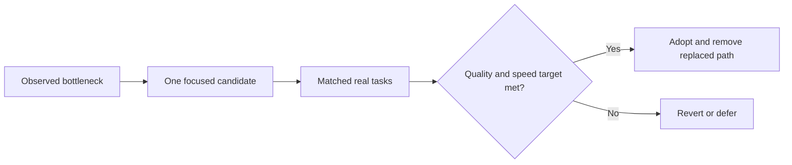

# Evaluation and future work

The November evaluation asked whether changing the harness helped an assistant
finish the same work more accurately or quickly. It covered tool use,
long-context continuation and browser workflows.

## Measured results

### Frozen comparison with native Codex

The evaluator recorded all 72 positions. It admitted 68 runs and recorded their
terminal outcomes, including failures. Four stopped before task input because
a prerequisite was missing. Fifteen cases
qualified for comparing all three configurations. Against the earlier custom
OpenClaw baseline, the candidate tied on quality in 13 cases, won one by
preserving labels and completed actions, and lost one by leaving a blank
browser tab open.

Seventeen pairs qualified for comparing the candidate with native Codex.
Both scored 100/100 on sixteen. On the remaining pair, the candidate scored
75 and Codex scored 100. Codex finished faster on sixteen of the seventeen.

| Group | Qualified pairs | Mean task quality (candidate / Codex) | Median completion time (candidate / Codex) |
| --- | ---: | ---: | ---: |
| Original configuration and observer | 9 | 100 / 100 | 199.5s / 122.6s |
| Updated configuration, original observer | 1 | 100 / 100 | 76.8s / 71.2s |
| Updated configuration and bounded observer | 7 | 96.4 / 100 | 341.1s / 153.8s |

The combined acceptance target was **unmet**. The private suite and rubrics
support these task-specific comparisons. Stock OpenClaw and Hermes were
outside the comparison, and subsequent deployments have their own results.

Separate compaction development checks preserved the required state in eight
cases per configuration. Summary calls fell from 16 to eight. The summary step
used 33.76% less time and 18.07% fewer provider tokens.

Fresh deployed checks subsequently demonstrated browser reuse, task-tab cleanup,
one final answer and correct incorporation of a user correction. The browser task
took 68.5s to its first useful finding and 78.3s to its final text. The delegated
correction task took 492.2s to final delivery. Its correction arrived before the
child finished, but the observer missed the exact native admission boundary, so
strict live-correction timing remains unqualified.

### An eight-task comparison through Discord

A later comparison assigned the same eight tasks to two releases with the same
model and reasoning effort. The earlier release recorded seven timing-qualified cases. Their
median time to useful work was 85 seconds and their median to final delivery
was 88 seconds.

On the newer release, six of the eight requests ended with a generic error in
Discord. The model produced answers, and the coding task also produced a
verified file edit. The sender dropped the thread identifier when publishing
the final. Two delegated answers reached Discord. One request differed from the
frozen text, and the other missed the window for a correction while its parent
was active. The original eight therefore yielded **zero qualified pairs for
comparing final-delivery speed**. A fast error gives the user no useful answer.

Both browser tasks reused the existing browser and restored the original tab.
Those checks establish browser cleanup even though their final replies failed.
The package regression test runs the compiled sender on an ordinary thread
request and a message recovered after restart, checking the original reply
reference and confirming that replaying the same incoming message ID produces
no additional send.

## What we learned

| Finding | Engineering lesson |
| --- | --- |
| The production tool interface differed from the interface used in a motivating benchmark. | Trace the actual deployed call path before changing an interface. |
| Split-turn compaction summarized the same prefix twice. | Remove duplicated work at its existing owner before adding a new memory layer. |
| A confirmed answer lost its delivery record when the system copied its conversation history. | Carry the platform message ID into the copy so recovery can verify what the recipient received. |
| Two requests in one conversation can both await a reply when a worker restarts. | Test both recovery orders. Check that each confirmed reply appears once on its original request. Record an unconfirmed send against its original request while the other request finishes. Retry only after confirming that the first attempt was unsent. |
| A platform can return a message ID for a text fallback after an upload fails. | Check the platform’s file receipt for each requested attachment and confirm that it names the intended destination before reporting the upload complete. |
| A user corrected the destination while a worker was preparing files. | Send the requester’s correction before the first upload. Verify each file at the corrected destination and each reply against its original message. A link from another participant must leave the destination intact. |
| A worker restarted with a clarification waiting in its queue. | Reopen the worker before its first external action. Check that the action uses the clarified request and that the user receives an answer to it. |
| Discord refused the first upload, yet recovery recorded it as possibly delivered. | After reopening the worker, distinguish a refused first upload, a partially delivered batch and an upload whose acknowledgment was lost. |
| A project review combined a broad failing test run with a narrower successful rerun. | Report the platform, tests and components covered by each run. Keep failures outside the rerun visible, and identify any simulated service that limits the conclusion. |
| A browser task read the desktop and extension manuals, then used only desktop control. | Choose the available route first. Load its instructions on demand and keep tab ownership with the tool that opened the tab. |
| A correct first draft replaced its documented example with an invented workflow after a request for a stronger revision. | Compare the first revision with the original source. A clearer example still needs evidence that the product supports it. |
| A request recovered after restart kept waiting after its agent's database was ready. | Measure that interval separately. Wake requests deferred for that database as soon as it is ready. Preserve the retry schedule for other failures. |
| A background command finished, but a muted alert setting suppressed its requested result. | Deliver the result to the conversation that started the command. Keep routine alerts quiet and verify the requester received the output once. |
| Some long delays contained very little tool-execution time. | Measure provider generation, preparation, queueing, compaction and tool time separately. |
| Observer timing and prompt/oracle disagreement affected acceptance. | Qualify the measurement route first and preserve setup failures in the results. |
| Successful local repairs did not establish an aggregate speed advantage. | Evaluate the user outcome, including waits, interventions and cleanup. |

Implemented mechanisms are mapped in the [runtime source chapter](20-runtime-source-changes.md).

## Proposed next experiments

### 1. Simplify the execution engine

Evaluate using a maintained native execution harness behind the existing
OpenClaw gateway and control plane. Keep the useful identity, account/project
knowledge, tools and delivery interface. Replace a duplicated execution path
where the candidate can own the full task lifecycle.

The central question is whether this reduces model/tool translation and repeated
coordination while preserving corrections, children, cancellation, authenticated
scope and final delivery. Adding an agent inside another competing agent loop
would defeat the purpose.

### 2. Match reasoning effort to the task

Compare a lower-effort path for routine retrieval, navigation and short edits
with the current high-effort configuration. Retain the strong reasoning path for
ambiguous planning and difficult engineering. Make selection observable and
preserve explicit operator choices. Adopt this only if completed-work quality
holds while response and completion times improve.

### 3. Keep context useful and tools direct

Retain concise identity, preferences and source pointers. Retrieve relevant
project facts when needed. Remove repeated instructions, stale procedure copies
and model calls that only rediscover information already available in trusted
context. Favor direct supported tool operations. Use the existing browser session
and lifecycle when visual interaction is needed.

### 4. Treat completion and cleanup as part of capability

Keep one task owner through corrections, compaction and delegated results. Verify
the requested effect, send one final answer, then retire task-owned resources.
Preserve user tabs and concurrent work. Measure memory and CPU alongside task
outcomes so a locally faster agent does not make the shared host unusable.

## A bounded decision process

A proposed next experiment compares one candidate on six tasks covering
source lookup, browser use, a reader-facing document, a code change, a
correction during delegated work and long-context continuation. Freeze tasks,
scoring and budgets first. Compare completed work, first useful response,
whole-task time, operator interventions and resource cleanup on comparable hosts.

A practical decision target is at least 30% lower median completion time with
preserved task quality and no critical privacy, wrong-account, duplicate-effect
or lost-objective failure. Keep all attempts, including provider and infrastructure
failures. Decide whether to adopt, revise or retire the candidate from that sample.

The [verification guide](15-evidence-audit-and-verification.md) defines evidence
boundaries. [Design decisions](18-architecture-evolution.md) explains the ownership
principles that any replacement must preserve.
